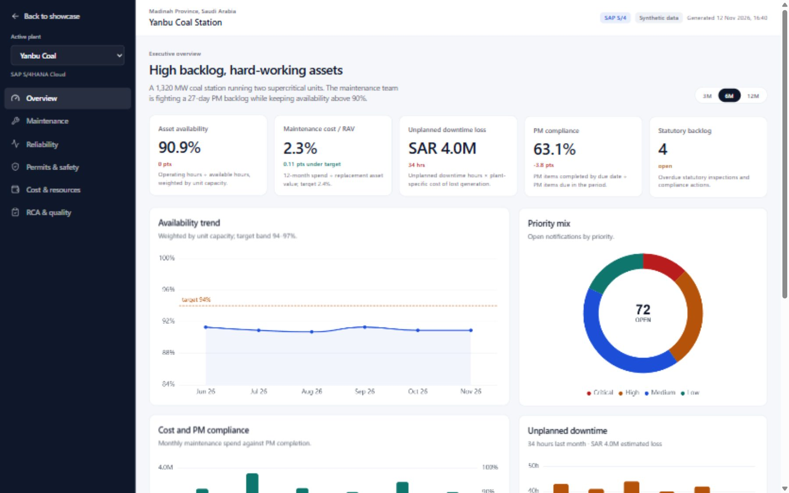

# Gearbox

### A Nirmana product

SAP landscape and maintenance intelligence.

Company codes, plants and business areas across S/4HANA and ECC R/3, with a four-plant maintenance command centre on top.

**Parent portfolio:** [nirmanaerp.com](https://nirmanaerp.com) — Gearbox, Pramaan, Promonitor and Yamuna

**Demo repository:** `cmms-demo`

**Live:** https://gearbox.nirmanaerp.com/ (the `github.io` project URL redirects here)

**Integration guide:** [Connecting Django to SAP S/4HANA](docs/Gearbox-SAP-Django-Integration-Guide.pdf)



Gearbox is the SAP landscape and maintenance intelligence product in the Nirmana
portfolio. This repository is a public, synthetic showcase of the SAP enterprise
structure across S/4HANA and ECC R/3, plus a CMMS wrapper over SAP, IBM Maximo
and Oracle EAM. It is intentionally independent of the private product
repository: no product code, client data, logos or database.

The ERP audit and S/4HANA implementation practice is **Pramaan**. **Promonitor**
and **Yamuna** complete the portfolio.

## Stack

- Next.js 15 (App Router, static export)
- Tailwind CSS 3
- Apache ECharts
- Framer Motion
- TypeScript

## Run

```bash
npm install
npm run dev
```

Open `http://localhost:3000`.

Production build:

```bash
npm run build
```

The static site is written to `out/`.

## Pages

- `/` — showcase landing page
- `/landscape` — SAP enterprise structure: company, company codes, plants, business areas and org units across S/4HANA and ECC R/3
- `/demo/[plant]` — executive command centre
- `/demo/[plant]/maintenance` — PM, backlog and work orders
- `/demo/[plant]/reliability` — MTBF/MTTR, pareto, bad actors, RCA
- `/demo/[plant]/ptw` — permits, isolation and cycle time
- `/demo/[plant]/cost` — cost / RAV, cost per MWh, cost mix
- `/demo/[plant]/rca-qa` — RCA, findings, CAPA, checklists, data quality
- `/data-model` — canonical entities, star schema, field ownership
- `/erp-integration` — adapters, SAP API inventory, what is real vs synthetic
- `/audit` — Pramaan ERP audit, SAP PM pack: 20 checks, scorecard, evidence, findings and remediation
- `/portfolio` — the Nirmana portfolio: Gearbox, Pramaan, Promonitor and Yamuna
- `/about` — scope and disclaimers

Plants: `coal`, `thermal`, `wind`, `gas`.

## Interactions

- **SAP landscape** — switch Combined / S/4HANA / ECC R/3; every KPI, table and configuration column follows the selected landscape.
- **Overview** — switch Source / Canonical / Variance, and model a PM compliance recovery.
- **Maintenance** — change available crew hours to see crew load and the over-capacity count.
- **Reliability** — remove a share of top-three bad-actor downtime to see loss avoided.
- **Permits** — filter open permits by age.

The scenario values are illustrative and run against the synthetic dataset. The
Source / Canonical difference is modelled for the demo.

## Data

All data is synthetic and deterministic. Plant and maintenance data is generated
in `lib/data.ts` from a seeded PRNG. The SAP landscape configuration lives in
`lib/landscape.ts` and is hand-authored for demonstration. There is no client
data and no live ERP call in this repository. Numbers are designed to be
plausible, not to represent any real company or plant.

## SAP landscape

Two synthetic SAP systems are configured:

- **SAP S/4HANA 2023** on SAP HANA 2.0, client 100: two company codes, four plants, one controlling area.
- **SAP ECC 6.0 EHP8** on Oracle 19c, client 100: two company codes, three plants, one controlling area.

The dashboard reads the company, company codes, plants, business areas,
controlling areas, sales organisations, purchasing organisations and storage
locations from both systems. A configuration matrix shows the source table and key for each object
(`T001`, `T001W`, `TGSB`, `TKA01`, `TVKO`, `T024E`, `T001L`).

## Decoupling

The demo has no dependency on the private product repository, its database or
its client branding. All content here is self-contained.

## Deploy

The site uses `output: "export"`, so it can be hosted on Vercel, Azure Static
Web Apps, Netlify or any static host.

- Vercel: import the repository and keep the default Next.js settings.
- Azure Static Web Apps: app location `/`, output location `out`.
- GitHub Pages: the workflow builds for the custom domain root. If you deploy
  to a project subpath instead (for example
  `https://<user>.github.io/cmms-demo/`), set
  `NEXT_PUBLIC_BASE_PATH=/cmms-demo` for the build.

## Status

This is a demonstration, not a certified product. The SAP landscape configuration
is synthetic; the SAP adapter is validated against a local simulator, not a
customer sandbox. The other ERP adapters are shown as planned until their APIs
are implemented and tested. Gearbox is the dashboard product; Pramaan is the ERP
audit and implementation vertical. Both names require trademark screening before
commercial use.
