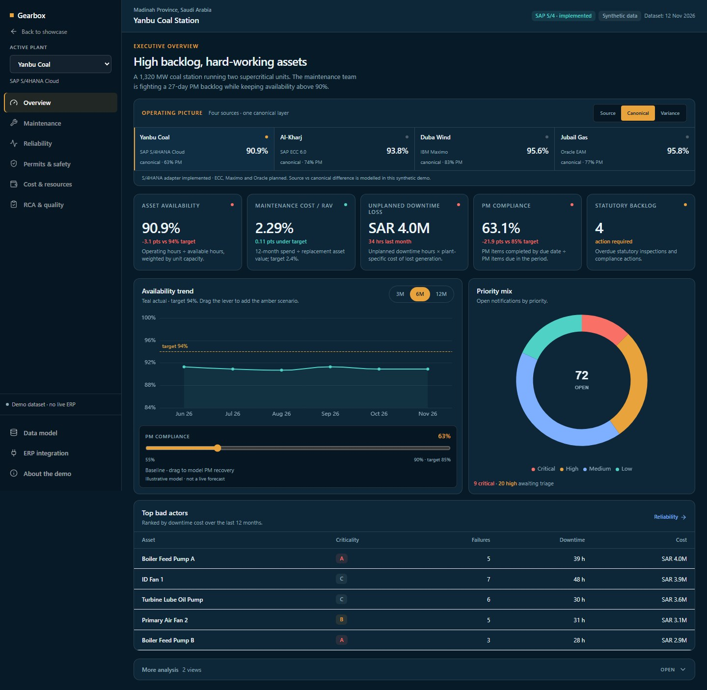

# Gearbox

Four plants. Four ERPs. One maintenance intelligence layer.

**Demo repository:** `cmms-demo`

**Live:** https://busdec.github.io/cmms-demo/



Gearbox is a public, synthetic showcase of a CMMS wrapper over SAP S/4HANA, SAP
ECC, IBM Maximo and Oracle EAM. It is intentionally independent of the private
product repository: no product code, client data, logos or database.

## Stack

- Next.js 15 (App Router, static export)
- Tailwind CSS 3
- Apache ECharts
- Framer Motion
- TypeScript

## Run

```bash
npm install
npm run dev
```

Open `http://localhost:3000`.

Production build:

```bash
npm run build
```

The static site is written to `out/`.

## Pages

- `/` — showcase landing page
- `/demo/[plant]` — executive command centre
- `/demo/[plant]/maintenance` — PM, backlog and work orders
- `/demo/[plant]/reliability` — MTBF/MTTR, pareto, bad actors, RCA
- `/demo/[plant]/ptw` — permits, isolation and cycle time
- `/demo/[plant]/cost` — cost / RAV, cost per MWh, cost mix
- `/demo/[plant]/rca-qa` — RCA, findings, CAPA, checklists, data quality
- `/data-model` — canonical entities, star schema, field ownership
- `/erp-integration` — adapters, SAP API inventory, what is real vs synthetic
- `/about` — scope and disclaimers

Plants: `coal`, `thermal`, `wind`, `gas`.

## Interactions

- **Overview** — switch Source / Canonical / Variance, and model a PM compliance recovery.
- **Maintenance** — change available crew hours to see crew load and the over-capacity count.
- **Reliability** — remove a share of top-three bad-actor downtime to see loss avoided.
- **Permits** — filter open permits by age.

The scenario values are illustrative and run against the synthetic dataset. The
Source / Canonical difference is modelled for the demo.

## Data

All data is synthetic and deterministic. It is generated in `lib/data.ts` from
a seeded PRNG; there is no client data and no live ERP call in this repository.
Numbers are designed to be plausible, not to represent any real plant.

## Decoupling

The demo has no dependency on the private product repository, its database or
its client branding. All content here is self-contained.

## Deploy

The site uses `output: "export"`, so it can be hosted on Vercel, Azure Static
Web Apps, Netlify or any static host.

- Vercel: import the repository and keep the default Next.js settings.
- Azure Static Web Apps: app location `/`, output location `out`.

## Status

This is a demonstration, not a certified product. The SAP adapter is validated
against a local simulator, not a customer sandbox. The other ERP adapters are
shown as planned until their APIs are implemented and tested. Gearbox is an
interim demo name; no final naming decision has been made.
